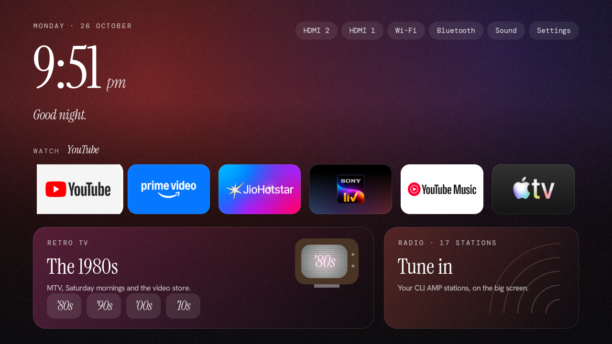
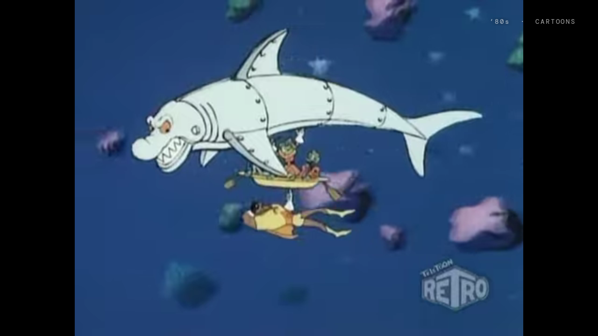
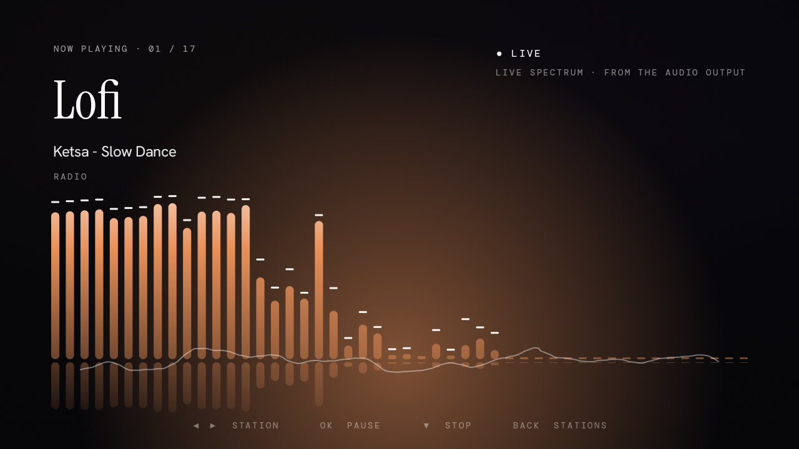
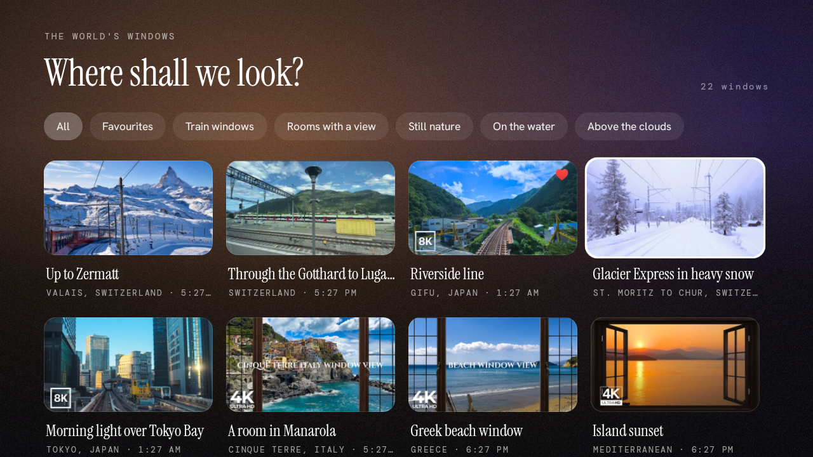
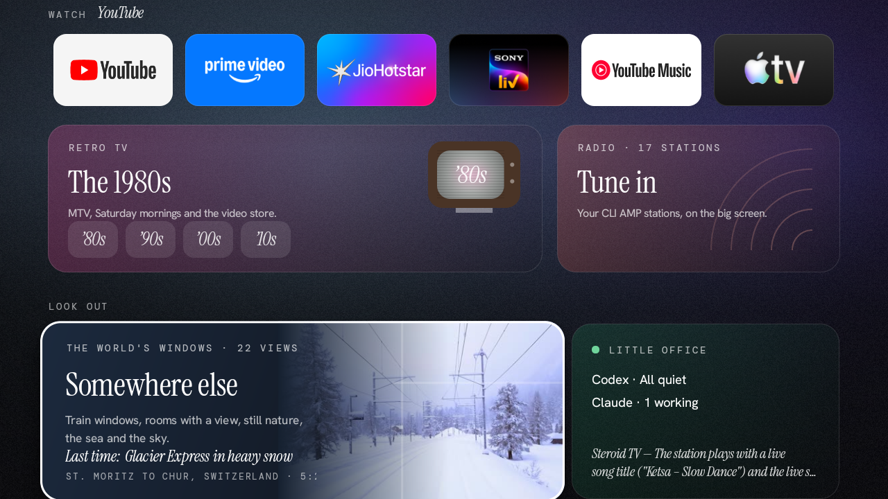

# Steroid TV

**Turn a cluttered Android TV into a calm, ad-free, beautiful one — with Claude doing the work.**



Steroid TV is a custom Android TV launcher plus a step-by-step playbook that **Claude Code** follows
to set it up on *your* TV. You answer a couple of questions (which apps you actually use, and
whether you want the optional extras); Claude connects to the TV over Wi-Fi, cleans it up,
builds the launcher and verifies everything.

It isn't a one-click patch: every TV is a little different, so Claude stays the brain. This repo
gives it everything we learned building the original — the code, the exact content choices, the
scripts, and a fix for every bug we hit — so your setup goes smoothly.

## What you get

| | |
|---|---|
| **A clean home screen** | Clock, greeting, your streaming apps — and nothing else. No ads, no sponsored rows, no "recommended for you". A slowly shifting ambient background that takes the colour of whatever you're on. |
| **Retro TV** | Channel-surf the **80s, 90s, 2000s and 2010s** by category — Cartoons, Music, TV shows, Movies, Comedy, Science — like flicking through real TV. Built for a basic remote: ◀ ▶ channel, ▲ ▼ category, OK pause. Programming from [MyRetroTVs](https://www.myretrotvs.com/). |
| **Radio** | Internet radio with a beautiful station browser and a full-screen Now Playing view with a visualizer that responds to the actual audio. Imports your [CLI AMP](https://github.com/bjarneo/cliamp) stations if you use it. |
| **The World's Windows** | 22 long, high-quality views with natural sound — Swiss and Japanese train windows, a room in Cinque Terre, Moraine Lake, the Norwegian coast, above the clouds. Leave one on. |
| **Little Office** *(optional)* | A small card showing whether Claude Code and Codex on your Mac are working or need you — so you can watch something without checking your computer. |
| **A cleaner, faster TV** | Ad, tracking and telemetry services switched off, unused apps disabled, snappier animations. All reversible with one script. |

<p>
 
 
</p>

## How to use it

You need: an **Android TV / Google TV** (Android 8+) on your Wi-Fi, a **Mac** (or Linux; Little
Office is Mac-only) and **[Claude Code](https://claude.com/claude-code)**.

```bash
git clone https://github.com/sanchit0212s/steroid-tv.git
cd steroid-tv
claude
```

Then tell Claude:

> Set up Steroid TV on my Android TV.

Claude reads [`CLAUDE.md`](CLAUDE.md) and takes it from there. It'll ask you to turn on developer
options on the TV (it walks you through it) and to accept one prompt on the screen. After that it
only asks:

1. **Which apps do you want to keep?** — just the apps you'd actually open, not system stuff.
2. **Import your CLI AMP radio stations?** — only if you have CLI AMP.
3. **Do you want Little Office?** — only if you use Claude Code or Codex.

Everything else — cleanup, building, installing, Retro TV, Radio, The World's Windows — is automatic.
Expect 20–40 minutes, most of it Claude working.

## Undo

Everything is reversible. Claude writes `backup/restore.sh` before changing anything:

```bash
backup/restore.sh
```

It re-enables every app it switched off and restores your original home screen.

## Customise

All in [`config/`](config/):

- `apps.json` — the apps on your home row (Claude writes it from your answers)
- `stations.json` — radio stations
- `windows.json` — The World's Windows (YouTube videos, places, moods)
- `features.json` — turn sections on or off
- `debloat.json`, `never-disable.txt` — what may / may never be switched off

Ask Claude to change any of it and rebuild.

## Honest limits

- A launcher **can't remove ads inside apps** (YouTube, Prime Video, etc.). YouTube may also show
  its own ads inside Retro TV and The World's Windows.
- Retro TV depends on MyRetroTVs and YouTube; clips that disappear are skipped automatically.
- Nothing here needs root or an unlocked bootloader — and it doesn't attempt either.

## Docs

The phase guides in [`docs/`](docs/) are written for Claude, but they're readable:
[requirements](docs/00-requirements.md) · [connect](docs/01-connect.md) · [apps](docs/02-apps.md) ·
[cleanup](docs/03-debloat.md) · [radio](docs/04-radio.md) · [windows](docs/05-worlds-windows.md) ·
[retro TV](docs/06-retro-tv.md) · [Little Office](docs/07-little-office.md) ·
[build](docs/08-build-install.md) · [verify](docs/09-verify.md) · [remote controls](docs/remote-controls.md) ·
[troubleshooting](docs/troubleshooting.md) · [architecture](docs/architecture.md)

## Credits

- Retro TV programming: [MyRetroTVs](https://www.myretrotvs.com/) by Joey Cato.
- Radio streams: [CLI AMP](https://github.com/bjarneo/cliamp) radio, [SomaFM](https://somafm.com/),
  laut.fm, Kalizo, radioBollyFM.
- The World's Windows: the YouTube creators credited on every window (Abao Ambience, lorirocks777,
  Oliver Hinz, Naturescapes, Nomadic Ambience, Framic window views, Skylite Productions, and more).
- Fonts: Instrument Serif, Hanken Grotesk, DM Mono — SIL Open Font License.

Videos and streams belong to their creators and are played through their official embeds/streams;
this project doesn't host or redistribute any media.

## License

Code: MIT (see [LICENSE](LICENSE)). Fonts: SIL OFL 1.1 (licences in `launcher/assets/fonts/`).
